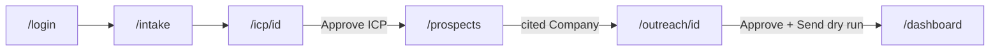
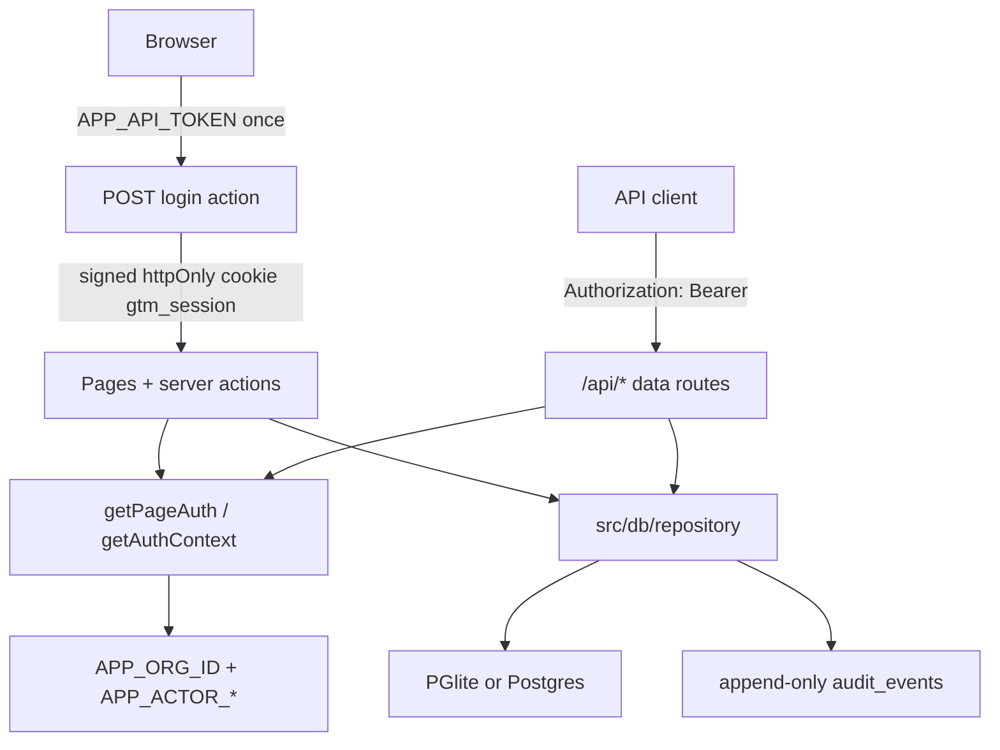

# Architecture

System overview for the AI GTM Engine. Slice-level contracts live in the linked docs; this file is the map.

The product is a **standalone closed-loop GTM engine**. A founder describes a product in plain language. The engine infers a scored ICP, finds named buyer organizations with cited evidence, drafts outreach grounded only in those citations, blocks any send behind a human approval gate, and shows the resulting pipeline on one dashboard. There is no real send path.

This repository does not share code, branding, secrets, or data with any other product.

## Runtime

| Layer | Choice |
| --- | --- |
| App | Next.js 16 App Router (`cacheComponents`), React 19, TypeScript strict |
| UI | Tailwind CSS 4, Radix / shadcn-ready (`components.json`, `cn()`) |
| Validation | Zod 4 (`src/domain/*` is the source of truth) |
| Persistence | Drizzle ORM + Postgres dialect. In-process [PGlite](https://pglite.dev) when `DATABASE_URL` is empty |
| LLM | `LlmClient` → DeepSeek OpenAI-compatible HTTP (`src/lib/llm`). Plain `fetch`, not the Vercel AI SDK |
| Search | `SearchClient` → Brave Search (`src/lib/search`). Plain `fetch` |
| Tests | Vitest + Testing Library. `pnpm test` never hits the network; `pnpm test:live` is optional |
| CI | GitHub Actions: install → typecheck → lint → test → build |
| Preview | Vercel GitHub integration. No production deploy until a merge to `main` is approved |

## Closed loop



Demo product: **ShiftPilot** (AI shift scheduling for hospitals and clinics) → US hospitals and health systems. See [DEMO_SCRIPT.md](./DEMO_SCRIPT.md).

## Request path

Two authenticated surfaces share the same server-side identity. Org and actor are **never** taken from the request body, query, or `x-actor-*` headers.



- **Pages** (`/intake`, `/icp`, `/prospects`, `/outreach`, `/dashboard`): `src/proxy.ts` redirects unauthenticated browsers to `/login?next=…`. The `next` target is allowlisted in `src/lib/login-redirect.ts`. After login the cookie is signed with `APP_API_TOKEN` and does not carry `orgId`.
- **Data APIs**: `getAuthContext` accepts the bearer token **or** the session cookie. Missing/invalid auth → **401**. Invalid bodies → **400**. Domain-rule violations → **400** with `{ code }`.
- **Public**: `GET /api/health`, `GET /api/llm/health`, `GET /api/search/health` (health routes read env only and never return keys).

## Repository layout

```
src/
  app/            pages, server actions, route handlers
  components/     UI (intake, ICP review, prospects, outreach, dashboard)
  db/             Drizzle schema, repository, migrate, seed
  domain/         Zod entities, enums, verification rules
  lib/
    auth.ts       bearer + session
    session.ts    cookie helpers for pages
    llm/          DeepSeek client
    search/       Brave client
    icp/          intake → scored ICP
    discovery/    Brave queries → cited prospects
    outreach/     citation-grounded drafts + HITL
    pipeline/     dashboard snapshot + stage derivation
drizzle/          committed SQL migrations (0000–0002)
docs/             this file and slice docs
```

## Auth

`readConfiguredSecret()` requires `APP_API_TOKEN` and a UUID `APP_ORG_ID`. Optional `APP_ACTOR_ID` / `APP_ACTOR_TYPE` (default `agent`). Browser sessions force `actorType: "human"`. Approve / reject / dry-run / pipeline moves require a human actor.

Token compare is constant-time. Cookie: `gtm_session`, httpOnly, `SameSite=lax`, 7-day max-age, `Secure` in production or on Vercel.

## Domain and evidence

Zod schemas in `src/domain/*` name every field. Drizzle tables in `src/db/schema.ts` use the same names. Full ER diagram and verification rules: [domain-model.md](./domain-model.md).

Invariants that every later slice must keep:

1. **Unknown ≠ verified.** A field without an assertion is `UNVERIFIED`. The engine must not invent a value and mark it verified.
2. **`VERIFIED` needs a citation** with `sourceUrl` and `retrievedAt`. Enforced in `src/domain/rules.ts`.
3. **Fictional / EXAMPLE `.example` URLs stay `UNVERIFIED`.**
4. **`INFERRED` is allowed without a URL** (model guess). Fit scores and rationales are always `INFERRED`.
5. **Citations are first-class.** URL, retrieved-at, quote, SHA-256 hash, extractor (`agent` | `human`), same org as the assertion.
6. **Every mutation is audited.** `withAudit` writes `audit_events` (`human` | `agent`, before/after JSON). The table is append-only (Postgres trigger; works in PGlite).

Discovery run snapshots live in `audit_events.after` (`discovery.run.*`). There is no `discovery_runs` table.

## Provider layers

Callers depend on interfaces, not vendor types.

| Interface | Live impl | Mock | Fail-closed |
| --- | --- | --- | --- |
| `LlmClient` (`chat`, `json`) | DeepSeek `/chat/completions` | `createMockLlmClient` | missing `DEEPSEEK_API_KEY` |
| `SearchClient` (`search`) | Brave web search | `createMockSearchClient` | missing `BRAVE_SEARCH_API_KEY` |

Both use platform `fetch`, timeouts via `AbortController`, and retries on **429 and 5xx only**. Search serializes calls at ≥1 req/s and rejects mock hits as citations (`isRealSearchEvidence` / `SearchSyntheticEvidenceError`).

`createLlmClient({ allowMockIfUnconfigured: true })` and the search equivalent are the only paths that substitute a labeled mock. LIVE discovery with a missing LLM **fails** — no silent heuristic fallback.

Details: [llm.md](./llm.md), [search.md](./search.md).

## Product slices

| ID | Surface | Role |
| --- | --- | --- |
| B001 | `/`, `/api/health` | Standalone repo, CI, hello-world |
| B002 | `/api/products`, `/api/companies/:id`, `/api/citations`, `/api/audit` | Domain model, evidence ledger, HITL outreach states |
| B003 | `/login`, `/intake`, `/icp/[id]` | Product intake → DeepSeek ICP → human approve |
| B003a | `src/lib/llm` | DeepSeek provider |
| B003b | `src/lib/login-redirect.ts` | Post-login `next` allowlist |
| B004 | `/prospects`, `/api/discovery/runs` | Live Brave discovery, named orgs only, cited claims |
| B004a | `src/lib/search` | Brave provider + synthetic-evidence guard |
| B008 | `/outreach`, `/outreach/[id]` | Citation-grounded email + LinkedIn draft; approve / reject / dry-run |
| B009 | `/dashboard` | One row per org, evidence labels, pipeline from recorded data only |

Not built on `main` yet: scoring/tiers as a standalone engine (B005), graph store (B006 — `relationship_edges` in Postgres is the stand-in), enrichment (B007), Band Desktop (B010), Flexprice / Snyk extras (B011), submission packaging (B012).

### Intake and ICP

`submitProductIntake` → `LlmClient.json` → shape-normalize → Zod. One repair retry. Invalid JSON is rejected. Fields stay `INFERRED` until a human clicks **Approve ICP**. Edits after approval create a new DRAFT version (`parentIcpId`). NAICS codes are checked against a committed 2022 list; unknown codes are flagged, not replaced. [icp-engine.md](./icp-engine.md).

### Discovery

3–6 deterministic Brave queries aimed at **named buyer organizations** (not listicles). LIVE extract + score with DeepSeek. Heuristic extract is MOCK-only. Candidates are classified `buyer | vendor_competitor | media_research`. Only buyers become prospects. Claims whose URL is not in the result set are dropped. Persist `Company` + `Citation` + `FieldAssertion` as `INFERRED`. HCA-style duplicates collapse by normalized org name/domain. [discovery.md](./discovery.md).

### Outreach

Drafts are refused unless the company has a citation-backed signal or claim. The model sees only those facts; returned `sourceUrls` are intersected with provided citation URLs. Seller product is always ShiftPilot. Legal transitions stay B002: `DRAFT → PENDING_APPROVAL → APPROVED → DRY_RUN_COMPLETED`. Approve from DRAFT hops through pending internally. **Send (dry run)** records `DRY_RUN_COMPLETED`, leaves `sentAt` empty, and contacts nobody. There is no `SENT` path in the UI. [outreach.md](./outreach.md).

### Dashboard

`loadDashboard` pins to the latest **completed** discovery run for the selected ICP (older completed runs stay selectable). One row per organization: fit score (`INFERRED`), rationale (`INFERRED`), cited evidence (`VERIFIED` / `INFERRED` / `source-candidate`).

Automatic board stages come **only** from recorded rows:

`MATCHED → DRAFTED → APPROVED → DRY_RUN_SENT (DRY_RUN_COMPLETED audit) → REJECTED`

`REPLIED`, `MEETING_BOOKED`, `CLOSED_LOST` are **manual** human moves stored as `pipeline.stage.move` audit events. Auto stages cannot be entered without the matching record. Later stages are never fabricated.

## Persistence

- Migrations in `drizzle/` (`0000_domain_model`, `0001_cto_review_guards`, `0002_icp_engine`). Applied by `pnpm db:migrate`, tests, and the first API request.
- `DATABASE_URL` set → `pg`. Empty → PGlite (local `.pglite/`; memory on Vercel and in tests).
- PGlite on Vercel serverless is **not durable**. Preview boots an empty in-memory database.
- B004 and B008 add no migration. Discovery runs and extra outreach fields reuse `audit_events` and `outreach.variant` JSON.

## HTTP surfaces

| Method | Path | Auth | Notes |
| --- | --- | --- | --- |
| GET | `/api/health` | public | `{ status, version, commit }` |
| GET | `/api/llm/health` | public | `{ configured, model }` from env |
| GET | `/api/search/health` | public | `{ configured, provider }` from env |
| GET/POST | `/api/products` | required | Zod create schema; no client `orgId` |
| GET | `/api/companies/[id]` | required | Company + field evidence for the server org |
| POST | `/api/citations` | required | |
| GET | `/api/audit` | required | |
| GET/POST | `/api/discovery/runs` | required | `maxDuration` 60s |
| GET | `/api/discovery/runs/[id]` | required | |
| GET/POST | `/api/outreach` | required | |
| GET | `/api/outreach/[id]` | required | |

Pages: `/`, `/login`, `/intake`, `/icp`, `/icp/[id]`, `/prospects`, `/outreach`, `/outreach/new`, `/outreach/[id]`, `/dashboard`.

## Testing and deploy

- `pnpm test` — unit + component; live files excluded.
- `pnpm test:live` — DeepSeek / Brave / integrated ShiftPilot flow; skips when keys are unset; excluded from CI.
- Preview: opening a PR is enough. Do not run `vercel` CLI deploys from this repository. Do not put real secrets in git.

## Related docs

| Doc | Scope |
| --- | --- |
| [DEMO_SCRIPT.md](./DEMO_SCRIPT.md) | Judge walkthrough |
| [domain-model.md](./domain-model.md) | Entities, ER, verification, HITL states |
| [icp-engine.md](./icp-engine.md) | Intake, inference, approval |
| [discovery.md](./discovery.md) | Live prospect discovery |
| [outreach.md](./outreach.md) | Drafts and the approval gate |
| [llm.md](./llm.md) | DeepSeek client |
| [search.md](./search.md) | Brave client |
