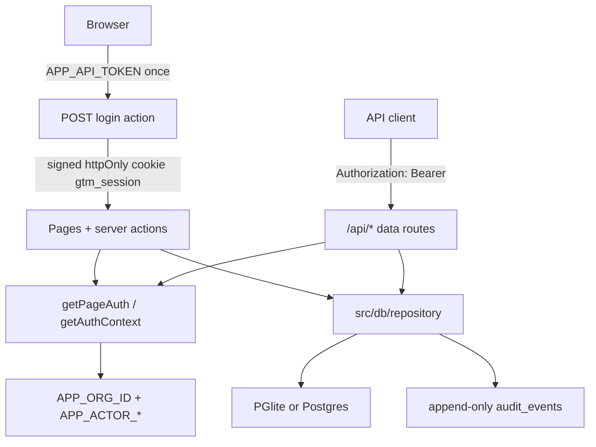

# Architecture

System overview for the AI GTM Engine. Slice-level contracts live in the linked docs; this file is the map.

The product is a **standalone closed-loop GTM engine**. A founder describes a product in plain language. The engine infers a scored ICP, finds named buyer organizations with cited evidence, drafts outreach grounded only in those citations, blocks any send behind a human approval gate, and shows the resulting pipeline on one dashboard. There is no real send path.

This repository does not share code, branding, secrets, or data with any other product.

## Runtime

| Layer | Choice |
| --- | --- |
| App | Next.js 16 App Router (`cacheComponents`), React 19, TypeScript strict |
| UI | Tailwind CSS 4, Radix / shadcn-ready (`components.json`, `cn()`) |
| Validation | Zod 4 (`src/domain/*` is the source of truth) |
| Persistence | Drizzle ORM + Postgres dialect. In-process [PGlite](https://pglite.dev) when `DATABASE_URL` is empty |
| LLM | `LlmClient` → DeepSeek OpenAI-compatible HTTP (`src/lib/llm`). Plain `fetch`, not the Vercel AI SDK |
| Search | `SearchClient` → Brave Search (`src/lib/search`). Plain `fetch` |
| Tests | Vitest + Testing Library. `pnpm test` never hits the network; `pnpm test:live` is optional |
| CI | GitHub Actions: install → typecheck → lint → test → build |
| Preview | Vercel GitHub integration. No production deploy until a merge to `main` is approved |

## Closed loop

```mermaid
flowchart LR
  login["/login"] --> intake["/intake"]
  intake --> icp["/icp/id"]
  icp -->|"Approve ICP"| discover["/prospects"]
  discover -->|"cited Company"| outreach["/outreach/id"]
  discover --> graph["/graph"]
  outreach -->|"Approve + Send dry run"| dash["/dashboard"]
  dash --> graph
```

Demo product: **ShiftPilot** (AI shift scheduling for hospitals and clinics) → US hospitals and health systems. See [DEMO_SCRIPT.md](./DEMO_SCRIPT.md).

## Request path

Two authenticated surfaces share the same server-side identity. Org and actor are **never** taken from the request body, query, or `x-actor-*` headers.



- **Pages** (`/intake`, `/icp`, `/prospects`, `/outreach`, `/dashboard`, `/pipeline`, `/graph`): `src/proxy.ts` redirects unauthenticated browsers to `/login?next=…`. The `next` target is allowlisted in `src/lib/login-redirect.ts`. After login the cookie is signed with `APP_API_TOKEN` and does not carry `orgId`.
- **Public demo**: `PUBLIC_DEMO_MODE=true` (or unset on Vercel Preview) skips the token/cookie gate. `getPageAuth` / `getAuthContext` / `proxy` map to the server `APP_ORG_ID` and a human demo actor. `/login` redirects to `/intake` (or `next`). `PUBLIC_DEMO_MODE=false` restores token auth. Expensive demo actions are rate-limited in `src/lib/demo-rate-limit.ts`.
- **Data APIs**: `getAuthContext` accepts the bearer token **or** the session cookie (or demo mapping). Missing/invalid auth → **401**. Invalid bodies → **400**. Domain-rule violations → **400** with `{ code }`. Demo rate-limit exceeded → **429**.
- **Public**: `GET /api/health`, `GET /api/llm/health`, `GET /api/search/health` (health routes read env only and never return keys).

## Repository layout

```
src/
  app/            pages, server actions, route handlers
  components/     UI (intake, ICP review, prospects, outreach, dashboard)
  db/             Drizzle schema, repository, migrate, seed
  domain/         Zod entities, enums, verification rules
  lib/
    auth.ts       bearer + session
    session.ts    cookie helpers for pages
    llm/          DeepSeek client
    search/       Brave client
    icp/          intake → scored ICP
    discovery/    Brave queries → cited prospects
    outreach/     citation-grounded drafts + HITL
    pipeline/     dashboard snapshot + stage derivation
    graph/        derived knowledge graph + Dijkstra path match
drizzle/          committed SQL migrations (0000–0002)
docs/             this file and slice docs
```

## Auth

`readConfiguredSecret()` requires `APP_API_TOKEN` and a UUID `APP_ORG_ID`. Optional `APP_ACTOR_ID` / `APP_ACTOR_TYPE` (default `agent`). Browser sessions force `actorType: "human"`. Approve / reject / dry-run / pipeline moves require a human actor.

Token compare is constant-time. Cookie: `gtm_session`, httpOnly, `SameSite=lax`, 7-day max-age, `Secure` in production or on Vercel.

## Domain and evidence

Zod schemas in `src/domain/*` name every field. Drizzle tables in `src/db/schema.ts` use the same names. Full ER diagram and verification rules: [domain-model.md](./domain-model.md).

Invariants that every later slice must keep:

1. **Unknown ≠ verified.** A field without an assertion is `UNVERIFIED`. The engine must not invent a value and mark it verified.
2. **`VERIFIED`** means the claim is backed by a real, retrieved, cited source URL (`sourceUrl` + `retrievedAt` on a Citation). Enforced in `src/domain/rules.ts`. It is **not** independently verified by a human or a second source. Discovery claim text is extracted by DeepSeek. `createFieldAssertion` rejects `VERIFIED` unless at least one linked citation has both fields. From the rule: *“A URL and timestamp are necessary but do not by themselves prove the claim is true.”*
3. **`INFERRED`** is model judgement without a source treated as proof: fit score, rationale, and ICP fields. Allowed without a URL. It is not treated as verified.
4. **`source-candidate`** is a search hit or claim whose URL is not among the verified retrieved results for that company.
5. **Citations are first-class.** URL, retrieved-at, quote, SHA-256 hash, extractor (`agent` | `human`), same org as the assertion.
6. **Every mutation is audited.** `withAudit` writes `audit_events` (`human` | `agent`, before/after JSON). The table is append-only (Postgres trigger; works in PGlite).

Seed / data policy (not a domain rule): the TEST hospital seed uses `https://example.com` and is labeled demo. `.example` URLs are not code-enforced as `UNVERIFIED`.

Discovery run snapshots live in `audit_events.after` (`discovery.run.*`). There is no `discovery_runs` table.

## Provider layers

Callers depend on interfaces, not vendor types.

| Interface | Live impl | Mock | Fail-closed |
| --- | --- | --- | --- |
| `LlmClient` (`chat`, `json`) | DeepSeek `/chat/completions` | `createMockLlmClient` | missing `DEEPSEEK_API_KEY` |
| `SearchClient` (`search`) | Brave web search | `createMockSearchClient` | missing `BRAVE_SEARCH_API_KEY` |

Both use platform `fetch`, timeouts via `AbortController`, and retries on **429 and 5xx only**. Search serializes calls at **at most 1 request per second** (`minIntervalMs` default 1000). Mock search hits cannot become citations (`isRealSearchEvidence` / `SearchSyntheticEvidenceError`).

`createLlmClient()` and `createSearchClient()` fail closed when the matching key is missing. ICP (`src/lib/icp/infer.ts` `createIcpLlmClient`) and outreach (`src/lib/outreach/generate.ts` `createOutreachLlmClient`) call `createMockLlmClient` directly when `DEEPSEEK_API_KEY` is unset (outreach still requires live DeepSeek for real, non-TEST companies). Only discovery search uses `createSearchClient({ allowMockIfUnconfigured: true })`. A missing DeepSeek key does **not** fail discovery: `resolveMode` labels the run **MOCK** and uses heuristic extract/score.

Details: [llm.md](./llm.md), [search.md](./search.md).

## Product slices

| ID | Surface | Role |
| --- | --- | --- |
| B001 | `/`, `/api/health` | Standalone repo, CI, hello-world |
| B002 | `/api/products`, `/api/companies/:id`, `/api/citations`, `/api/audit` | Domain model, evidence ledger, HITL outreach states |
| B003 | `/login`, `/intake`, `/icp/[id]` | Product intake → DeepSeek ICP → human approve |
| B003a | `src/lib/llm` | DeepSeek provider |
| B003b | `src/lib/login-redirect.ts` | Post-login `next` allowlist |
| B004 | `/prospects`, `/api/discovery/runs` | Live Brave discovery, named orgs only, cited claims |
| B004a | `src/lib/search` | Brave provider + synthetic-evidence guard |
| B008 | `/outreach`, `/outreach/[id]` | Citation-grounded email + LinkedIn draft; approve / reject / dry-run |
| B009 | `/dashboard` | One row per org, evidence labels, pipeline from recorded data only |
| B014 | `/graph` | Derived knowledge graph + automated seller→prospect path match |

Not built on `main` yet: scoring/tiers as a standalone engine (B005), graph store (B006 — `relationship_edges` in Postgres is the stand-in; B014 derives a demo graph in memory from existing records), enrichment (B007), Band Desktop (B010), Flexprice / Snyk extras (B011), submission packaging (B012).

### Intake and ICP

`submitProductIntake` → `LlmClient.json` → shape-normalize → Zod. One repair retry. Invalid JSON is rejected. Fields stay `INFERRED` until a human clicks **Approve ICP**. Edits after approval create a new DRAFT version (`parentIcpId`). NAICS codes are checked against a committed 2022 list; unknown codes are flagged, not replaced. [icp-engine.md](./icp-engine.md).

### Discovery

3–6 deterministic Brave queries aimed at **named buyer organizations** (not listicles). LIVE (`resolveMode`: Brave + DeepSeek) extract + score with DeepSeek. MOCK uses heuristic extract/score. Candidates are classified `buyer | vendor_competitor | media_research`. Only buyers become prospects. Claims whose URL is not in the result set are dropped. `persist.ts` writes cited fact claims (`name`, `domain`, …) as `VERIFIED` (citation `sourceUrl` + `retrievedAt` from the Brave hit). Only `fitScore` and `rationale` are stored as `INFERRED`. HCA-style duplicates collapse by normalized org name/domain. [discovery.md](./discovery.md).

### Outreach

Drafts are refused unless the company has a citation-backed signal or claim. The model sees only those facts; returned `sourceUrls` are intersected with provided citation URLs. Seller product is always ShiftPilot. Legal transitions stay B002: `DRAFT → PENDING_APPROVAL → APPROVED → DRY_RUN_COMPLETED`. Approve from DRAFT hops through pending internally. **Send (dry run)** records `DRY_RUN_COMPLETED`, leaves `sentAt` empty, and contacts nobody. There is no `SENT` path in the UI. [outreach.md](./outreach.md).

### Dashboard

`loadDashboard` pins to the latest **completed** discovery run for the selected ICP (older completed runs stay selectable). One row per organization: fit score (`INFERRED`), rationale (`INFERRED`), cited evidence labeled `VERIFIED` / `INFERRED` / `source-candidate` (see Domain and evidence).

Automatic board stages come **only** from recorded rows. `REJECTED` is a **separate branch**, not a step after dry-run. `deriveAutoStage` priority:

`dryRun (DRY_RUN_SENT) > approved (APPROVED) > draft (DRAFTED) > rejected (REJECTED) > matched (MATCHED)`

`REPLIED`, `MEETING_BOOKED`, and `CLOSED_LOST` are **manual** human-asserted stages stored as `pipeline.stage.move` audit events (actor + timestamp). They are not system-verified. Auto stages cannot be entered without the matching record.

### Graph

`loadGraph` pins to the same latest **completed** discovery run as the dashboard (older completed runs stay selectable). The graph is **derived** in process from stored ICP, product, run snapshot, claims, and citations. No new tables. Nodes that cannot be read from those records are omitted.

| Node | Source |
| --- | --- |
| Seller | Intake product name (or the stored product summary prefix) |
| ICP | Selected ICP |
| Attribute | ICP industries / NAICS, personas, trigger summaries |
| Prospect | Named orgs on the run (HCA-style duplicates collapsed) |
| Claim | Stored discovery claims |
| Source | Claim `sourceUrl` |

| Edge | Evidence |
| --- | --- |
| seller `DEFINES` ICP | `INFERRED` (ICP fields are model judgement) |
| ICP `TARGETS` industry / persona / signal | `INFERRED` |
| prospect `IN_INDUSTRY` / `HAS_SIGNAL` attribute | From cited claims, signals, or stored industry/fit text. `VERIFIED` only when a retrieved cited source URL backs the mention |
| claim `ABOUT` prospect | Same label as the claim |
| claim `CITES` source | Same label as the claim |

**Automated matching** is weighted shortest path (Dijkstra) from the seller (fallback: ICP) to each prospect. Edges are treated as undirected for search. Weights: `VERIFIED = 1`, `INFERRED = 3`, `source-candidate = 5`. Ties break by hop count, then lexicographic node-id sequence, then prospect name. Unreachable prospects (no derived attribute link) are omitted from the ranking. The explanation is built only from node labels and edge source URLs, e.g. `ShiftPilot → US hospitals ICP → NAICS 622110 → Montefiore, evidence: https://…`.

`VERIFIED` still means the claim is backed by a real, retrieved, cited source URL — not independently verified by a human or a second source.

MOCK runs are labeled. Empty runs show an honest empty state. No sample graph is injected.

## Persistence

- Migrations in `drizzle/` (`0000_domain_model`, `0001_cto_review_guards`, `0002_icp_engine`). Applied by `pnpm db:migrate`, tests, and the first API request.
- `DATABASE_URL` set → `pg`. Unset → in-process PGlite (local default `.pglite/`; memory in tests).
- Vercel Preview uses Postgres via `DATABASE_URL` (Neon), not in-memory PGlite.
- B004 and B008 add no migration. Discovery runs and extra outreach fields reuse `audit_events` and `outreach.variant` JSON.

## HTTP surfaces

| Method | Path | Auth | Notes |
| --- | --- | --- | --- |
| GET | `/api/health` | public | `{ status, version, commit }` |
| GET | `/api/llm/health` | public | `{ configured, model }` from env |
| GET | `/api/search/health` | public | `{ configured, provider }` from env |
| GET/POST | `/api/products` | required | Zod create schema; no client `orgId` |
| GET | `/api/companies/[id]` | required | Company + field evidence for the server org |
| POST | `/api/citations` | required | |
| GET | `/api/audit` | required | |
| POST | `/api/discovery/runs` | required | `maxDuration` 60s |
| GET | `/api/discovery/runs/[id]` | required | |
| GET/POST | `/api/outreach` | required | |
| GET/POST | `/api/outreach/[id]` | required | POST actions: `edit`, `regenerate`, `approve`, `reject`, `dry-run` |

Pages: `/`, `/login`, `/intake`, `/icp`, `/icp/[id]`, `/prospects`, `/outreach`, `/outreach/new`, `/outreach/[id]`, `/dashboard`, `/pipeline`, `/graph`.

## Testing and deploy

- `pnpm test` — unit + component; live files excluded.
- `pnpm test:live` — DeepSeek / Brave / integrated ShiftPilot flow; skips when keys are unset; excluded from CI.
- Preview: opening a PR is enough. Do not run `vercel` CLI deploys from this repository. Do not put real secrets in git.

## Known limitations

- If Brave is configured but DeepSeek is not, `resolveMode` labels the run **MOCK** and heuristic extract/score still runs. Because `search.provider !== "mock"`, `persistProspects` (`src/lib/discovery/pipeline.ts` ~L300) may persist those prospects. Tracked as follow-up; not fixed during freeze.

## Related docs

| Doc | Scope |
| --- | --- |
| [DEMO_SCRIPT.md](./DEMO_SCRIPT.md) | Judge walkthrough |
| [domain-model.md](./domain-model.md) | Entities, ER, verification, HITL states |
| [icp-engine.md](./icp-engine.md) | Intake, inference, approval |
| [discovery.md](./discovery.md) | Live prospect discovery |
| [outreach.md](./outreach.md) | Drafts and the approval gate |
| [llm.md](./llm.md) | DeepSeek client |
| [search.md](./search.md) | Brave client |
