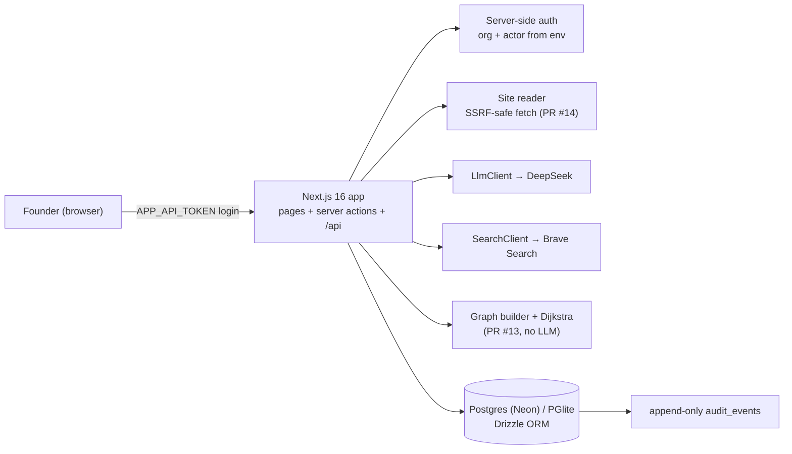

# Seed to Saga — System Design (for judges)

> `SYSTEM_DESIGN.pdf` in this folder is an earlier design baseline (branch b004a). This `.md` describes the current build, and the code is the source of truth.

## 1. What it does

A founder describes a product, or just enters its website. The AI drafts an ideal customer profile (ICP) and finds real buyer organizations on the live web, with cited sources.
It scores fit, draws a knowledge graph that shows *why* each prospect matches, and drafts outreach that uses only cited facts.
A human approves every step. Sending is a **dry run only**. Nothing is ever sent automatically.

## 2. Architecture

## 3. Pipeline steps

| # | Step | What happens | AI or deterministic | Output |
|---|---|---|---|---|
| 0 | Website intake *(open PR #14)* | Reads up to 3 pages of your site. DeepSeek suggests intake fields. Empty fields are highlighted so you see what is still missing. | AI (fields marked INFERRED, with page source) | Pre-filled intake form |
| 1 | Intake → ICP | DeepSeek turns the description into industries (NAICS), personas and buying signals. NAICS codes are checked against the 2022 list. | AI + deterministic check | Draft ICP, INFERRED until a human approves |
| 2 | Discovery | 3–6 Brave queries for **named buyer organizations**. DeepSeek extracts claims. Claims whose URL is not in the search results are dropped. Vendors and media are filtered out. | Search + AI extraction + deterministic filters | Prospects with cited claims |
| 3 | Fit scoring | Fit score and rationale per prospect | AI (INFERRED) | Ranked prospects |
| 4 | Knowledge graph *(open PR #13)* | Builds nodes and edges from stored data and finds the best path from seller to each prospect | Deterministic | Graph + highlighted best-match path |
| 5 | Outreach drafts | Email + LinkedIn draft. The model only sees cited facts. Returned URLs must match the provided citations. | AI, grounded | Draft per prospect |
| 6 | Human gate | Approve, edit or reject. "Send" records `DRY_RUN_COMPLETED` and contacts nobody. | Human | Audited state change |
| 7 | Dashboard / Pipeline | One row per organization with evidence labels. The pipeline kanban has drag-and-drop *(open PR #12)*. | Deterministic stages + manual moves | Pipeline view |

## 4. Trust & evidence model

Every fact carries a label:

- **VERIFIED**: backed by a real, retrieved, cited source URL (URL + retrieved-at timestamp). This is **not** independent verification by a human or a second source.
- **INFERRED**: model judgement (ICP fields, fit score, rationale).
- **SOURCE-CANDIDATE**: a URL that is not among the retrieved results for that company.
- Unknown stays **UNVERIFIED**. The engine never invents a value and marks it verified.

Rules are enforced in code (`src/domain/rules.ts`). Mock search hits can never become citations. Citations store URL, timestamp, quote and SHA-256 hash. Every change is written to an append-only audit log, with who did it (human or agent).

## 5. Knowledge graph & path matching (open PR #13, `/graph`)

- **Nodes:** Seller, ICP, ICP attribute (NAICS / persona / signal), Prospect, Claim, Source.
- **Edges:** Seller `DEFINES` ICP. ICP `TARGETS` attribute. Prospect `IN_INDUSTRY` / `HAS_SIGNAL` attribute, found by deterministic text matching of its cited claims and signals. Claim `ABOUT` prospect. Claim `CITES` source.
- **Line style:** solid = VERIFIED, dashed = INFERRED, dotted = source-candidate.
- **Matching:** Dijkstra from the seller. Edge weights are VERIFIED 1, INFERRED 3, source-candidate 5, so paths backed by real sources win. Tie-breaks are deterministic. There is no LLM in the matching and no invented nodes. A prospect with no attribute overlap is unreachable, and the graph says so.
- **Example (ShiftPilot demo run on the preview):** 47 nodes, 119 edges, 12 paths found. The best match is Baystate Health via the CMIO / IT Director persona, backed by a Baystate job posting.

## 6. Safety

- **Human in the loop:** ICP approval, outreach approve/reject, dry-run and pipeline moves all require a human actor.
- **Dry run only:** there is no real send path in the UI. `sentAt` stays empty.
- **Auth:** you log in with a bearer token (`APP_API_TOKEN`) or a signed httpOnly session cookie. Org and actor come from server env, never from the request. Token comparison is constant-time.
- **Secrets:** API keys live only in the hosting environment (Vercel). None are in the repo. Health endpoints never return keys.
- **SSRF-safe site reader (open PR #14):** https only, public IPs only (private and reserved ranges are blocked), every redirect is re-checked, max 3 pages, 8 s timeout, 1.5 MB per page.
- **Fail-closed providers:** missing keys mean no live calls. Mock mode is clearly labeled.

## 7. Tech stack

Next.js 16 (App Router), React 19, TypeScript (strict), Tailwind CSS v4 + shadcn-style UI, Zod 4, Drizzle ORM on Postgres (Neon on Vercel Preview) or in-process PGlite, DeepSeek (OpenAI-compatible HTTP), Brave Search, Vitest + Testing Library, GitHub Actions CI (typecheck, lint, test, build), Vercel preview deploys.

## 8. Status

**On `main`:** login, intake → ICP, live discovery with citations, fit scoring, outreach drafts with the human gate and dry run, dashboard with evidence labels and pipeline stages, audit log.

**Open draft PRs (passing CI, not yet merged):**
- PR #12: Seed to Saga redesign, Pipeline tab, drag-and-drop kanban.
- PR #13: knowledge graph and path matching at `/graph`.
- PR #14: "Read my site" website intake autofill.

**Known limitations (honest):**
- Runs on Vercel **Preview** only. There is no production deploy yet.
- VERIFIED means "cited source retrieved", not fact-checked.
- Graph attribute links use keyword text matching. Quality depends on the claim text.
- NAICS suggestions can be imprecise. Unknown codes are flagged, not replaced.
- If Brave is configured but DeepSeek is not, a run is labeled MOCK, but its prospects may still be persisted. This is a tracked follow-up.
- US hospitals / health systems is the only demo market tested end to end. Other markets are UNVERIFIED.
