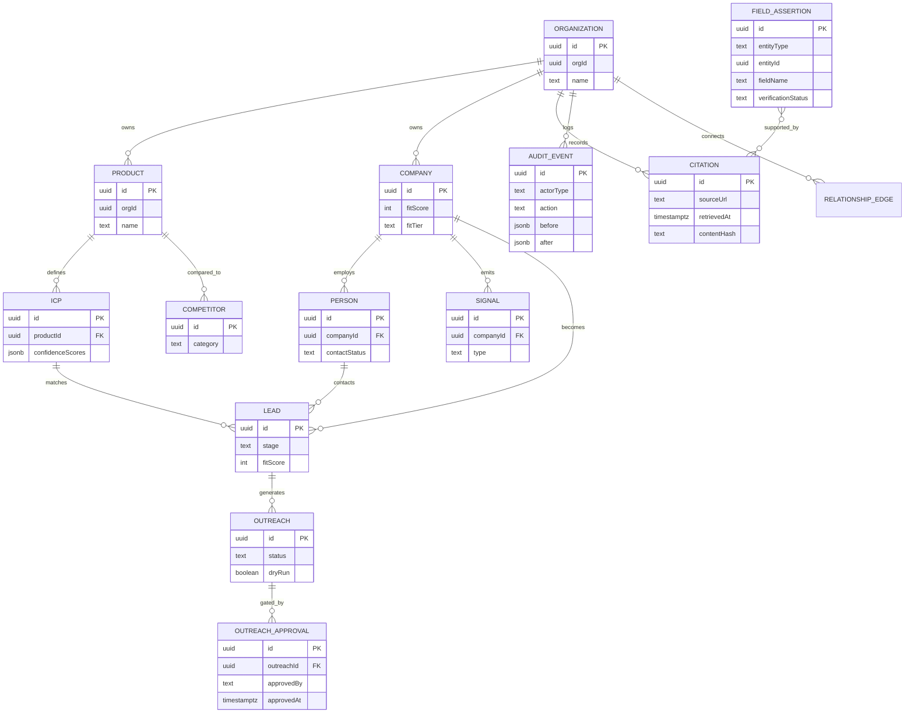

# Domain model and evidence ledger

B002 persistence and API contracts for the AI GTM Engine. Zod schemas in `src/domain/*` are the source of truth; TypeScript types are inferred from them; Drizzle tables in `src/db/schema.ts` use the same field names.

## Entities

Every row has `id`, `orgId` (multi-tenant ready), `createdAt`, and `updatedAt`.

| Entity | Role |
| --- | --- |
| Organization | Tenant container. For the org row itself, `orgId === id`. |
| Product | Intake output: features, capabilities, constraints, pricing. |
| ICP | Inferred buyer profile with field-level confidence `0.00–1.00`. |
| Company | Account with optional fit/intent scores `0–100` and tier A/B/C. |
| Person | Decision-maker. `contactStatus`: UNVERIFIED, VERIFIED, BOUNCED, OPTED_OUT. |
| Competitor | DIRECT / INDIRECT / ALTERNATIVE landscape row. |
| Signal | Buying or negative telemetry (hire, funding, freeze, …). |
| Lead | Pipeline card. Stages: MATCHED → CONTACTED → REPLIED → MEETING_BOOKED → CLOSED_LOST. |
| Outreach | Drafted message. Status: DRAFT → PENDING_APPROVAL → APPROVED → SENT / DRY_RUN_COMPLETED / REJECTED. `dryRun` defaults to `true`. Dry-run is never `SENT`. |
| OutreachApproval | HITL record (`approvedBy`, `approvedAt`, decision). |
| Citation | Evidence ledger row (source URL, retrieved-at, quote, hash, extractor). |
| FieldAssertion | Claim that a specific entity field has a value, with verification status. |
| AuditEvent | Append-only mutation log (human or agent). |
| RelationshipEdge | Relational stand-in for graph edges (`WORKS_AT`, `COMPETES_WITH`, …). |

## ER diagram

## Verification rules

`verificationStatus` is one of `VERIFIED | INFERRED | UNVERIFIED | REJECTED`.

1. **Unknown ≠ verified.** A field without an assertion is returned as `UNVERIFIED` with an empty citation list. Missing values stay `null`; the engine must not invent a value and mark it verified.
2. **A claim cannot be `VERIFIED` without evidence.** `createFieldAssertion` rejects `VERIFIED` unless at least one linked citation has both `sourceUrl` and `retrievedAt`. Enforced in `src/domain/rules.ts` and covered by tests.
3. **A URL + `retrievedAt` is necessary but not sufficient.** Those fields prove a source was recorded, not that the claim is true. `VERIFIED` is reserved for a real retrieved source that a reviewer or trusted extractor has accepted. Fictional or EXAMPLE `.example` URLs stay `UNVERIFIED`.
4. **Citations are first-class.** Each citation stores `sourceUrl`, `retrievedAt`, `sourceType`, a quote/snippet, a SHA-256 `contentHash`, and `extractor` (`agent` | `human`). Citations and the target entity must belong to the same org as the assertion.
5. **INFERRED** is allowed without a URL (model guess). It is not treated as verified.

`GET /api/companies/:id` returns both the raw company row and a `fields` map of `{ value, verificationStatus, citations }`.

## HITL and outreach

- Default create path: `DRAFT` + `dryRun: true`.
- Legal transitions: `DRAFT → PENDING_APPROVAL | REJECTED`, `PENDING_APPROVAL → APPROVED | REJECTED`, `APPROVED → SENT | DRY_RUN_COMPLETED | REJECTED`. Terminal: `SENT`, `DRY_RUN_COMPLETED`, `REJECTED`.
- `SENT` requires an `outreach_approvals` row for the **same outreach and org** with explicit decision `APPROVED`, `approvedBy`, and `approvedAt`. Undefined, `REJECTED`, another outreach, or another org all fail.
- A dry-run is never recorded as `SENT`. After approval it becomes `DRY_RUN_COMPLETED` and `sentAt` stays empty. Only a real (non-dry-run) send sets `sentAt`.

## Audit

`withAudit` wraps every repository mutation in a transaction and appends an `audit_events` row: actor type (`human` | `agent`), `actorId`, action, entity type/id, `before` / `after` JSON, timestamp. The table is append-only at the database level: a Postgres trigger raises on `UPDATE` or `DELETE` (works in PGlite too).

## Persistence

- Postgres dialect via Drizzle ORM. SQL migrations live in `drizzle/` and are committed.
- If `DATABASE_URL` is set and non-empty, the client uses `pg`.
- Otherwise it uses in-process [PGlite](https://pglite.dev). Local CLI defaults to `.pglite/`; tests and Vercel (no URL) use memory.
- `pnpm db:migrate` applies migrations idempotently (Drizzle journal table). Tests and the first API request also apply them.
- PGlite on Vercel serverless is **not durable**. Preview endpoints start from an empty in-memory database until a real `DATABASE_URL` is provided.

## API (thin contracts)

| Method | Path | Contract |
| --- | --- | --- |
| GET/POST | `/api/products` | Auth required. Zod `createProductApiSchema` (no client `orgId`) |
| GET | `/api/companies/[id]` | Auth required. Company + field evidence for the server org only |
| POST | `/api/citations` | Auth required. Zod `createCitationApiSchema` |
| GET | `/api/audit` | Auth required. `auditListQuerySchema` (no client `orgId`) |
| GET | `/api/health` | Public |

Data endpoints return **401** unless `getAuthContext` succeeds. Org and actor come only from server env (`APP_API_TOKEN` → `APP_ORG_ID` / `APP_ACTOR_*`). Query, body, and `x-actor-*` headers are ignored. Invalid bodies return **400**. Domain-rule violations return 400 with `{ code }`.

## Graph note

The product spec names Neo4j / Kùzu for multi-hop reasoning (B006). This slice stores entities and typed `relationship_edges` in Postgres as the system of record so evidence and audit stay transactional. B006 can project the same edges into a graph store.
